# falloutbos-recomp

> **Fork.** This is [pumorizzz/falloutbos-recomp](https://github.com/pumorizzz/falloutbos-recomp),
> maintained by [pumorizzz](https://github.com/pumorizzz) and forked from
> [sp00nznet/falloutbos-recomp](https://github.com/sp00nznet/falloutbos-recomp).
> The original project and the xboxrecomp toolkit are by
> [sp00nznet](https://github.com/sp00nznet). This fork adds a Direct3D 11
> render back end, the graphics and stability fixes it took to play the
> Tutorial and Carbon, and a one-click setup. It builds against the toolkit
> fork [pumorizzz/xboxrecomp](https://github.com/pumorizzz/xboxrecomp), branch
> `gpu-rastr`.


Static recompilation of **Fallout: Brotherhood of Steel (Xbox, 2004)** to a
native Windows executable, using [xboxrecomp](https://github.com/sp00nznet/xboxrecomp).

No emulation. The x86 in `default.xbe` is translated to C, compiled, and linked
against the xboxrecomp runtime (kernel replacement, NV2A pushbuffer executor,
MCPX APU, USB). The game shipped on Xbox and PS2 only; there was never a PC
version.

This repo follows the xboxrecomp house style (layout, `regen.sh`, netlab
recipe) shared with [hl2-recomp](https://github.com/sp00nznet/hl2-recomp) and
the other titles. **It contains no game code or data.** The generated C is
derived from your own disc and is never distributed; you produce it locally.

## Status

**Playable from power-on through the Tutorial and Carbon** (to the warehouse
radscorpions and back to the mayor), with a pad or the keyboard, saving to the
hard disk as it goes.

- **Drawn on the GPU** (Direct3D 11) by default, presented straight from a
  swapchain, capped at 60 fps. With the cap lifted, Carbon's spawn point
  runs at about 146 fps and Ruby's bar at about 130 fps (RTX 3080 Ti); the
  CPU rasteriser, still there with `RECOMP_GPU_RASTER=0`, manages about 17.
- **Checked frame by frame against a PS2 playthrough** of the same places
  (there is no Xbox capture to compare with): steam, lasers, radiation pools,
  pit, crates, character shadows, grenade explosions, Carbon's streets, bar
  and warehouse.
- **0 faults and 0 unresolved indirect calls**; `boot_check` 8/8 on both the
  CPU and the GPU path.

| Step | State |
|---|---|
| XBE parsed | done: entry `0x0009547C`, 28 sections, 122 kernel imports, XDK 5558 |
| Disassembled | done: 3,881 functions (no RTTI in this image) |
| Codegen | done: 3,888 functions, 543k lines of C, 1 unresolved target (`sgdt`, never reached) |
| Kernel bridge | done: 122/122 imports resolved |
| D3D device + display mode | done: 640x480 X8R8G8B8 |
| DirectSound / APU | done: the title starts the APU itself, streams create |
| Async file streaming | done: needs deferred I/O APCs (see [docs/boot.md](docs/boot.md)) |
| Bink FMV | done: Interplay logo, intro, menu background, no block artifacts |
| Controller | done: the title's own USB stack enumerates the modelled pad |
| Menus to gameplay | done: character select, difficulty, chapter intro |
| Tutorial | **played through**, graphics match the PS2 reference |
| Carbon | **played** to the warehouse and back, graphics match the PS2 reference |
| Saves | written to `saves\UDATA\49500008` |
| Later chapters | not played yet |

What it took to boot, and why, is in [docs/boot.md](docs/boot.md).

## Screenshots

*From live play with `Play.cmd`, GPU path, 60 fps.*

### Tutorial

| | | |
|:---:|:---:|:---:|
| 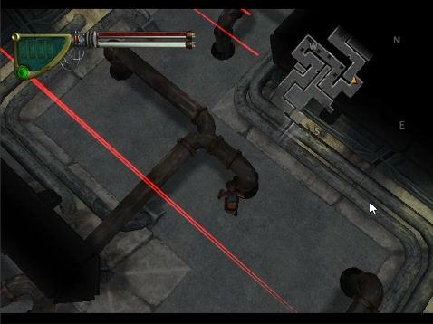 | 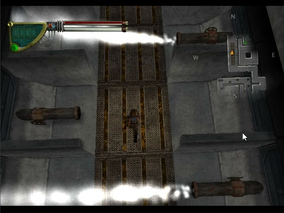 | 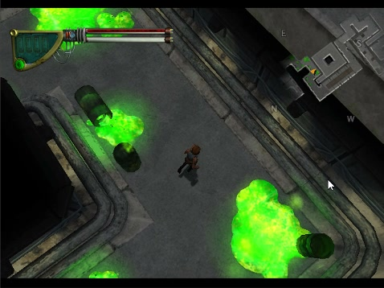 |
| Laser grid: the beams' glow is point sprites | Steam vents, point sprites too | Radiation pools and barrels |
| 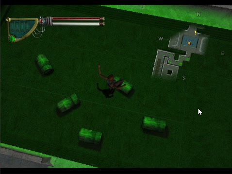 | 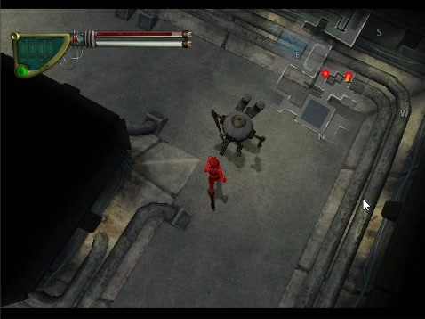 | 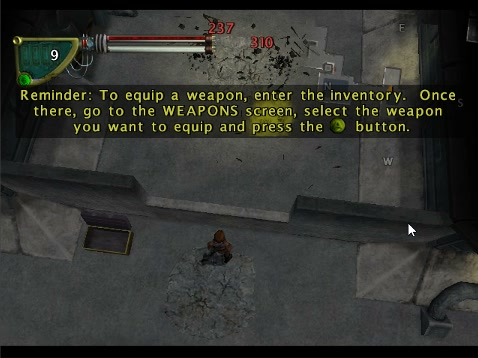 |
| The radioactive pit, green as on the PS2 | Melee training | A frag grenade: debris, scorch mark, damage |

### Carbon

| | | |
|:---:|:---:|:---:|
| 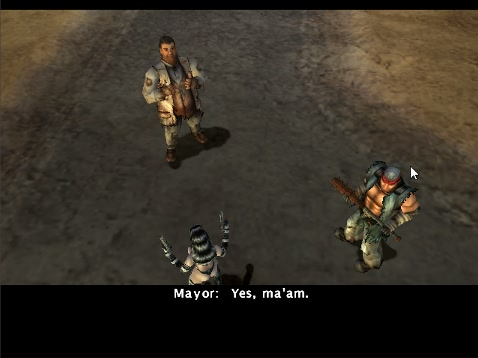 | 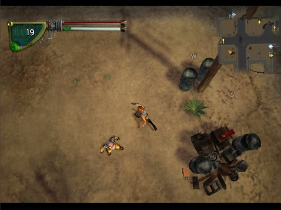 | 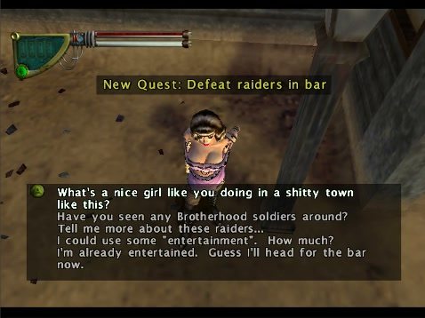 |
| The opening cut-scene | Carbon's streets | Ruby |
| 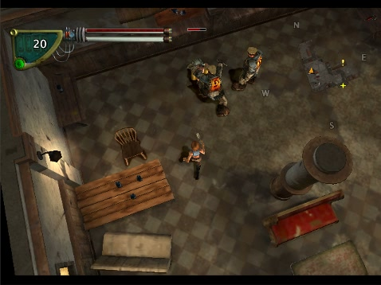 | 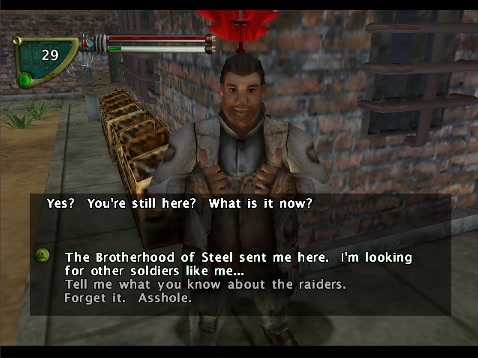 | 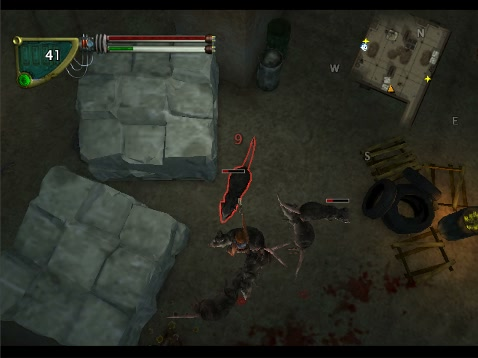 |
| The bar fight | The mayor | Radscorpions in the warehouse |
| 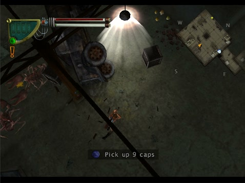 | 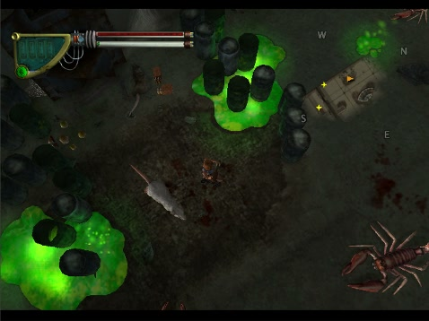 | 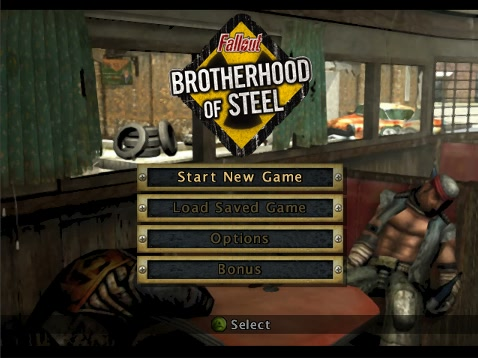 |
| Lamplight in the warehouse | Toxic pools | Back to the main menu |

## What this fork fixed

Everything below lives in the toolkit fork's `gpu-rastr` branch unless it says
"port"; each toolkit change has a test in `deps/xboxrecomp/tests`.

### Rendering on the GPU

- **Direct3D 11 back end** (`RECOMP_GPU_RASTER`). The executor still
  transforms and clips on the CPU; the GPU rasterises with depth and stencil,
  and the NV2A register combiners run in one ubershader, a line-for-line port
  of the software path's combiner. Frames are presented from a swapchain, and
  colour surfaces reach guest RAM only when the title can see them (flip,
  texture decode, eviction).
- **Render targets used as textures** stay on the GPU: the main frame's
  downsample, the swizzled HUD target and the character shadow atlas are read
  straight from the render target, not through a write-back per draw.
- **Device loss** (driver reset, TDR) hands drawing back to the CPU
  rasteriser at the next flip instead of crashing.
- `RECOMP_GPU_RASTER=compare` draws every frame on both paths and reports how
  far they differ.

### Graphics, on both paths

- **Particles were missing altogether.** Point sprites (`BEGIN_END 1`) were not
  drawn: steam (so it hurt with nothing visible), laser glow, radiation pools,
  smoke and the shadow atlas. They are drawn now, sized in screen pixels.
- **Red, oversaturated crates and target robots.** Fallout's lighting program
  multiplies garbage light colours (`inf`) by a zero intensity; on NV2A a
  product with 0 is 0, in the interpreter it was NaN. `MUL`/`MAD` now follow
  the hardware, with a vectorised mask so it costs nothing.
- **The radioactive pit was opaque black.** An input with no vertex array reads
  the last `SET_VERTEX_DATA*` value, which is how the liquid gets its
  translucent green.
- **Character shadows fell apart.** The shadow target is swizzled; it is now
  read as such.
- **Explosion decals flickered**: polygon offset was ignored.
- **Needles and slabs near the camera.** Triangles behind the near plane are
  clipped against `SET_CLIP_MIN` geometrically and against `SET_CLIP_MIN/MAX`
  per pixel. On the GPU, depth beyond `zmax` no longer clamps to 1.0 and
  punches black stripes into Carbon's floor.
- **A stale render target overwrote memory the title had reused** (with heap
  reclaim on): it is now dropped instead of written back. This was the likely
  cause of orange "splinters" in grenade explosions.
- **White and coloured blocks in Bink video** were a lifter bug, not graphics:
  `movsx ebp, bp` zero-extended, and Bink's inverse DCT read negative
  coefficients as large positive ones. The build re-runs `./regen.sh` by
  itself when the toolkit's codegen changes.
- **Lost pushbuffer commands at the ring's wrap** (a menu frame without its
  Bink background, a wedge of garbage vertices, a black frame): the port walks
  the ring like the DMA engine does (`RECOMP_PB_WALK=dma`, port default).

### Stability

- **Hang loading the Tutorial.** The executor now owns the D3D fence: it
  signals D3D's BlockOnFence event as it retires work, and a lost kick-off
  (D3D is not thread-safe, the title's threads run on several cores) is
  kicked after 250 ms.
- **Out of contiguous memory after ten minutes in the Tutorial**: freed memory
  is reclaimed by default (`RECOMP_HEAP_RECLAIM=1`, port).
- **Freeze on the main menu with `intro.bik` looping.** Fallout closes its
  `.clp` archive handles twice at every load; when the freed handle went
  straight to the next object, the second close destroyed a Bink worker's
  event under it. Handles are now handed out in turn.
  `NtDuplicateObject(DUPLICATE_CLOSE_SOURCE)` releases the source handle (and
  its async-I/O mark) the same way.

### Speed

- The vertex program is decoded once per program, not once per vertex, and an
  index list's repeated vertices are transformed once.
- Vertex programs of large batches run on several threads, bit for bit as on
  one (`RECOMP_VSH_THREADS`): by Ruby's bar, uncapped, 66 → 130 fps.
- A 10-second stutter is gone: the executor's periodic report no longer reads
  the GPU's render targets back.
- 60 fps cap at the flip by default (`RECOMP_FPS_LIMIT`); without it menus ran
  at up to 1000 fps and menu input misbehaved.

### Setup and play (port)

- `Setup.cmd`: checks and (after asking) installs the prerequisites, finds the
  disc image, unpacks it, generates the C and builds; resumes where it
  stopped. Without network it keeps the toolkit already there and says git's
  own reason.
- `Play.cmd`: windowed, GPU by default, pad or keyboard; F9 records your input
  into `saves\pad_path.txt`, F10 plays it back.

## Checks

| Check | Result | Command |
|---|---|---|
| Boot milestones, Interplay logo to Carbon, scripted pad | **8/8**, CPU and GPU path | `py -3 tools/boot_check.py`, `RECOMP_GPU_RASTER=1 py -3 tools/boot_check.py` |
| Toolkit tests for this work (D3D11 back end on WARP, combiners, FFP, batches, vertex programs and threads, near clip, points, fence, kernel bridge) | 10 suites, all pass | each `deps/xboxrecomp/tests/<name>`: `cmake -S . -B build && cmake --build build --config Release && ctest --test-dir build -C Release` |
| The title's own functions, native vs lifted (xboxrecomp `--xbe`, with #229) | 269 vectors, **3 mismatches** (x87 exception flags; one scratch overrun) | `(cd deps/xboxrecomp && py -3 -m tools.conformance --only corpus --xbe ../../game/default.xbe --xbe-limit 400)` |
| Live play against a PS2 playthrough | Tutorial and Carbon match | by eye, frame by frame |

`boot_check` fails only on a regression against `config/boot_check_baseline.json`,
and prints SKIP on a machine without game data. It is the netlab QA step
(`netlab check falloutbos-recomp`).

### Known issues

- A stippled floor and dotted floor tiles with black holes were seen in a few
  early runs; neither shows in live play with the current build, and their
  cause was not proven.
- Lines (`BEGIN_END` 2-4) are not drawn; the Tutorial never uses them.
- After a GPU device loss, whatever lived only on the GPU (the frame in
  progress, depth) is gone, and one frame shows the previous image.

## Getting Started

You need your own **Fallout: Brotherhood of Steel (USA)** disc image (`.iso`).
Nothing from the game is downloaded or included.

### Quick start

1. Download [pumorizzz/falloutbos-recomp](https://github.com/pumorizzz/falloutbos-recomp)
   ([ZIP](https://github.com/pumorizzz/falloutbos-recomp/archive/refs/heads/main.zip),
   or clone it) and unpack it.
2. Double-click **`Setup.cmd`**. It checks for Python, Git, CMake and the
   Visual Studio C++ build tools, and **asks before installing** anything
   missing (with what, why and how big). It finds your disc image or asks for
   it, then unpacks it, generates the C, and builds. Expect 10-20 minutes the
   first time, most of it the build. If it stops, it says why in one sentence
   and keeps the details in `setup.log`; running it again resumes.
3. Double-click **`Play.cmd`**. An XInput controller (Xbox 360/One pad) is
   player 1; the keyboard works too: WASD left stick, IJKL right stick,
   Z/X/C/V = A/B/X/Y, Enter = Start, Backspace = Back, 1/3 = triggers.
   F9 starts and stops recording what you do into `saves\pad_path.txt`; F10
   plays that recording back from where you stand, e.g. to repeat a route.
   It draws on the GPU (Direct3D 11). For the CPU rasteriser, run it from a
   console after `set RECOMP_GPU_RASTER=0`.

### Step by step

These are the commands `Setup.cmd` runs.

Prerequisites: Windows 10/11 x64; Python 3.10+ with `capstone`
(`py -3 -m pip install capstone`); Git for Windows (it provides `bash`);
CMake 3.20+; Visual Studio 2022 or its Build Tools with the C++ workload.
Use `py -3`, not `python`: the Microsoft Store alias for `python` is not a real
install. After installing anything, open a new terminal so PATH picks it up.

1. Get this repo and the toolkit. The port needs toolkit changes not upstream
   yet (see [Toolkit changes](#toolkit-changes)); `gpu-rastr` in
   [pumorizzz/xboxrecomp](https://github.com/pumorizzz/xboxrecomp) has them all:

   ```bash
   git clone https://github.com/pumorizzz/falloutbos-recomp falloutbos
   cd falloutbos
   git clone --branch gpu-rastr https://github.com/pumorizzz/xboxrecomp deps/xboxrecomp
   ```

2. Unpack your disc into `game/`:

   ```bash
   (cd deps/xboxrecomp && py -3 -m tools.xiso unpack "/path/to/Fallout - Brotherhood of Steel (USA).iso" -o ../../game)
   ```

   Expected: `extracted 491 files to ../../game`.

3. Generate the C (about 3 minutes, most of it the disassembler):

   ```bash
   RECOMP=deps/xboxrecomp ./regen.sh --disasm
   ```

   Expected, at the end:

   ```
   3888/3889 functions (0 failed), 543025 lines of C, 8 source files
   1 unresolved call targets stubbed (addresses called but not detected as functions)
   ```

4. Build:

   ```bash
   cmake -S . -B build-msvc -A x64 -DXBOXRECOMP_DIR=deps/xboxrecomp
   cmake --build build-msvc --config Release
   ```

   The executable lands in `bin/fbos.exe`.

5. Run from the repo root (it reads `game/default.xbe`), or use `Play.cmd`:

   ```bash
   RECOMP_PB_EXEC=1 RECOMP_FB_WINDOW=1 RECOMP_KEYBOARD=1 RECOMP_GPU_RASTER=1 ./bin/fbos.exe
   ```

## Usage

| Variable | Effect |
|---|---|
| `RECOMP_PB_EXEC=1` | execute the title's NV2A pushbuffer, so it actually draws |
| `RECOMP_FB_WINDOW=1` | show the framebuffer in a window. Off by default: runs are headless |
| `RECOMP_GPU_RASTER=1` \| `warp` \| `compare` | rasterise on the GPU (Direct3D 11) instead of the CPU: `1` a hardware adapter (WARP if none), `warp` the WARP software adapter, `compare` both paths draw and each flip prints how far the GPU differs from the software result, `0` the CPU. `Play.cmd` sets `1` unless it is already set; `fbos.exe` alone draws on the CPU. Needs `RECOMP_PB_EXEC=1`; without a D3D11 device it stays on the CPU |
| `RECOMP_FPS_LIMIT=<hz>` | cap the frame rate at the flip, standing in for vblank: 60 by default, `0` turns it off. Without it menus and loading screens run at up to 1000 fps and menu input misbehaves |
| `RECOMP_VSH_THREADS=N` | threads for a batch's vertex programs, the executor included (default: half the logical processors, at most 16); `1` runs them all on the executor |
| `RECOMP_PB_WALK=dma` | walk the pushbuffer ring as the DMA engine does; the port sets it, since the toolkit's default walk loses commands at the ring's wrap |
| `RECOMP_HEAP_RECLAIM=1` | reuse memory the title frees; the port sets it, or the Tutorial runs out of contiguous memory after about ten minutes |
| `RECOMP_GPU_RASTER_PRESENT=0` | with `RECOMP_GPU_RASTER`, show the window through GDI from guest RAM instead of presenting from the GPU |
| `RECOMP_GPU_RASTER_PRESENT_DUMP=prefix` | with `RECOMP_GPU_RASTER`, write every 30th shown frame (HUD included) as `prefixNNNNNN.bmp`; `RECOMP_GPU_RASTER_PRESENT_DUMP_EVERY=N` changes the interval |
| `RECOMP_GPU_RASTER_LOSE_AT=<flip>` | with `RECOMP_GPU_RASTER`, act out a GPU device loss at that flip (the CPU rasteriser takes over) |
| `RECOMP_FB_DUMP=prefix` | write frames as `prefix00000.bmp` ... |
| `RECOMP_FB_DUMP_FLIPS=<file>` | dump every flip while `<file>` exists |
| `RECOMP_WATCHDOG_SECS=N` | after N seconds, report where the guest is |
| `RECOMP_KERNEL_LOG_BUDGET=N` | log the first N kernel calls (default 200) |
| `RECOMP_KEYBOARD=1` | keyboard as player 1 (see Getting Started) |
| `RECOMP_PAD_SCRIPT="ms:button,..."` | scripted presses for headless runs, e.g. `25000:start,35000:a` |
| `RECOMP_PAD_RECORD=<file>` | in the window, F9 records pad 1 into `<file>` (on/off), F10 plays it back from that moment; timed in flips. `Play.cmd` uses `saves\pad_path.txt`; a line `replay` in `RECOMP_PAD_LIVE` also plays it. `RECOMP_PAD_RECORD_FROM_START=1` records from the window opening on, `=play` replays such a recording from there |
| `RECOMP_USB_STATS=1` | controller transfer counts every few seconds |
| `RECOMP_RASTER_THREADS=N` | CPU rasteriser worker threads (default: logical cores - 4). On a 6-core/12-thread CPU, 10 gave about 19 fps against 17; 12 starves the game and drops to 9 |
| `FBOS_PROFILE=<start>,<secs>` | sample every thread for `<secs>` seconds starting at `<start>`, print the top functions per thread |

`RECOMP_AC97_READY` and `RECOMP_USB` are set by `main.c` itself: the title
cannot initialise DirectSound without the first, or see a controller without
the second.

From power-on to Carbon, headless:

```bash
S="25000:start,35000:a,50000:a,65000:a"
for t in $(seq 80000 5000 250000); do S="$S,$t:a"; done
RECOMP_PAD_SCRIPT="$S" RECOMP_PB_EXEC=1 RECOMP_FB_DUMP=shot ./bin/fbos.exe
```

Headless capture, no window, works over RDP:

```bash
RECOMP_PB_EXEC=1 RECOMP_FB_DUMP=shot ./bin/fbos.exe
```

## Building from source

`./regen.sh` re-runs func_id, ABI analysis and codegen from the existing
disassembly; `./regen.sh --disasm` starts from the XBE. `RECOMP=<path>` points
it at a toolkit checkout other than `../xboxrecomp`. Entry tracing for
bring-up: list addresses in `config/trace_functions.json` and run
`TRACE_FUNCS=config/trace_functions.json ./regen.sh`.

`cmake --build` re-runs `./regen.sh` on its own when the toolkit's codegen
(`tools/recomp`, `tools/func_id`, `tools/abi_analysis`) is newer than the
last regen (`src/game/recomp/gen/.regen_stamp`), so a lifter fix pulled with
the toolkit reaches the game. `-DFBOS_AUTO_REGEN=OFF` turns that off.

Day-to-day builds go through [recomp-netlab](https://github.com/sp00nznet/recomp-netlab):
`netlab build falloutbos-recomp` (recipe `projects/falloutbos-recomp.env`).
The farm never sends `game/` or the disc image.

### Toolkit changes

Found by this port, each on its own branch in xboxrecomp:

| Branch | What |
|---|---|
| `fix/conformance-xbe-unimpl` ([#229](https://github.com/sp00nznet/xboxrecomp/pull/229)) | the real-title conformance harness builds on this game and no longer overruns on wide strings |
| `fix/disasm-tables-in-code-sections` ([#227](https://github.com/sp00nznet/xboxrecomp/pull/227)) | function-pointer tables inside XDK code sections (D3D's render-state handlers) |
| `fix/io-apc-delivery` ([#226](https://github.com/sp00nznet/xboxrecomp/pull/226)) | file I/O APC: restore esp after delivery; opt-in delivery at the next alertable wait |
| `perf/raster-batch-rows` ([#228](https://github.com/sp00nznet/xboxrecomp/pull/228)) | rasterise a draw's triangles together on the worker pool: 5.5 → 15 fps in Carbon |
| `perf/nv2a-quiet-poll` ([#230](https://github.com/sp00nznet/xboxrecomp/pull/230)) | no stderr line per pushbuffer kick under `RECOMP_PB_EXEC`: menus 20-22 → 25-28 fps |
| `perf/raster-pipeline` ([#231](https://github.com/sp00nznet/xboxrecomp/pull/231), on #228) | batches drawn by the workers while the executor decodes the next: 15.5 → 17.4 fps in Carbon |
| `gpu-rastr` ([pumorizzz/xboxrecomp](https://github.com/pumorizzz/xboxrecomp), on `work/falloutbos`) | everything in [What this fork fixed](#what-this-fork-fixed): the D3D11 back end, the graphics fixes on both paths, the fence, handle and speed work, with tests |
| community PR #186 | `pushfd`/`popfd`/`cpuid` lifted as the hardware does them. Until it lands, `recomp_manual.c` overrides the one function that needs it |

## License

MIT, see [LICENSE](LICENSE). That covers the code in this repo only.
Fallout: Brotherhood of Steel and its data belong to their owners; nothing from
the game is in this repo, and the generated C is never committed.
