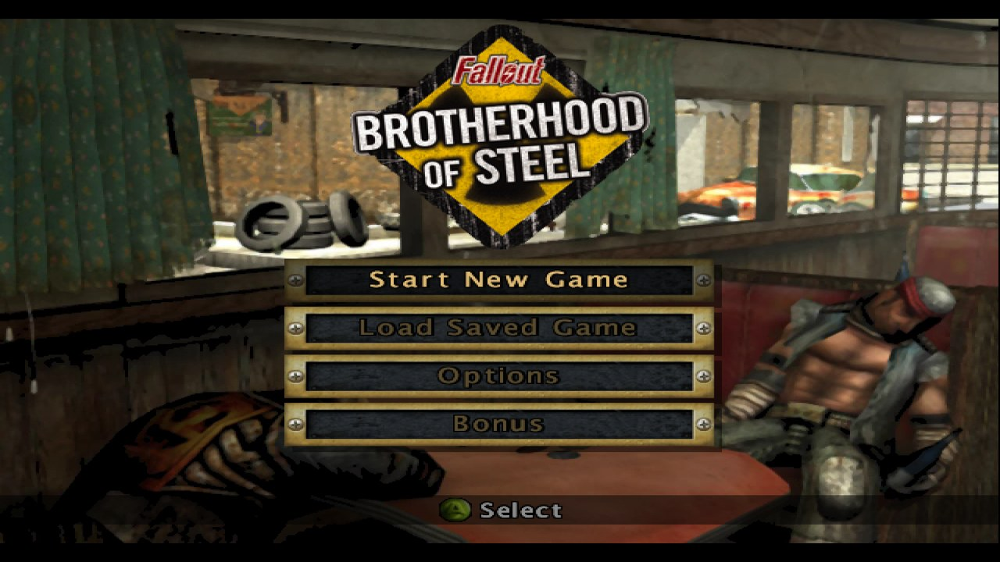
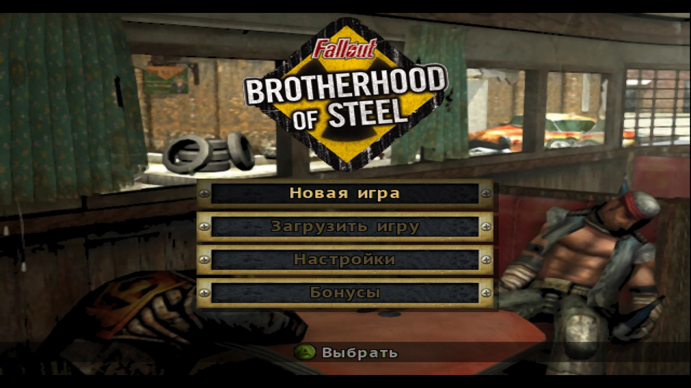
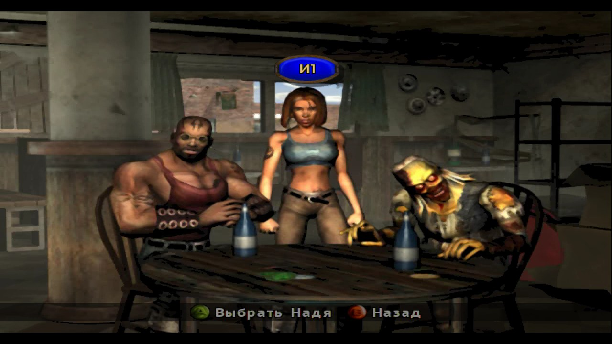
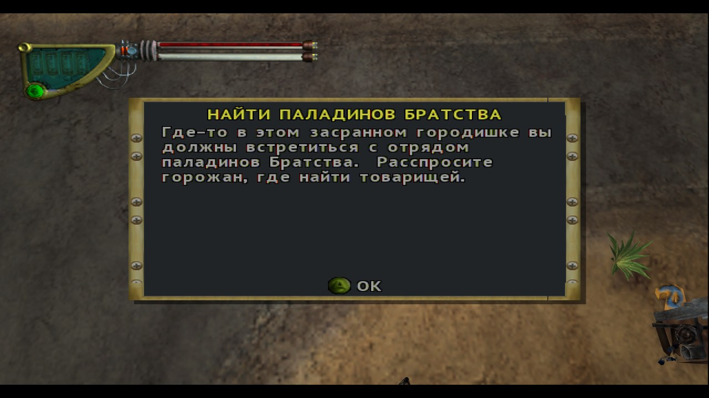

# Fallout: Brotherhood of Steel — native PC port

**Static recompilation of Fallout: Brotherhood of Steel (Xbox, 2004) into a native
Windows executable.** No emulator: the x86 in `default.xbe` is translated to C,
compiled, and linked against the [xboxrecomp](https://github.com/sp00nznet/xboxrecomp)
runtime, which stands in for the Xbox kernel, the NV2A GPU, the APU and USB. The
game shipped on Xbox and PS2 only; there was never a PC version.



> **Fork.** [pumorizzz/falloutbos-recomp](https://github.com/pumorizzz/falloutbos-recomp),
> forked from [sp00nznet/falloutbos-recomp](https://github.com/sp00nznet/falloutbos-recomp);
> the original port and the xboxrecomp toolkit are by
> [sp00nznet](https://github.com/sp00nznet). It builds against the toolkit fork
> [pumorizzz/xboxrecomp](https://github.com/pumorizzz/xboxrecomp), branch `gpu-rastr`.
>
> **No game code or data is in this repository.** You need your own disc image; the
> C is generated from it on your machine and never distributed.

## Highlights

| | |
|---|---|
| **Direct3D 11 rendering** | The NV2A's work is drawn on the GPU, register combiners in one ubershader, presented from a swapchain. Capped at 60 fps; uncapped, Ruby's bar runs at about 130 fps (RTX 3080 Ti). |
| **16:9, up to 4K** | Nemesis2000's widescreen patch mapped onto the USA disc, 16:9, 16:10 or 4:3 chosen in the launcher; the GPU renders at up to 4x the game's resolution (6x5 at 16:10) with SSAA up to 4x and MSAA up to 8x; borderless full screen on F11. |
| **Russian translation** | Every line of dialogue, quest, menu and hint, item names, and Cyrillic drawn into the game's own fonts. English or Russian is picked in the launcher. |
| **Launcher** | `bin\FalloutLauncher.exe`: aspect, resolution, SSAA, MSAA, picture size, full screen, frame-rate limit, language. |
| **Pad or keyboard** | XInput pads (Xbox 360/One) through the game's own USB stack; full keyboard mapping. |
| **Checked** | Frame by frame against a PS2 playthrough; `boot_check` 8/8 from power-on to Carbon; 0 faults, 0 unresolved calls. |

## Screenshots

| | |
|:---:|:---:|
|  |  |
| The main menu in Russian | Character select |
|  |  |
| Carbon, the first quest | The original English |

*Live captures of the current build: 1600x900 window, rendered at 3x with 4x MSAA.*

## Quick start

You need your own **Fallout: Brotherhood of Steel (USA)** disc image (`.iso`).

1. **Download** this repository ([ZIP](https://github.com/pumorizzz/falloutbos-recomp/archive/refs/heads/main.zip)
   or `git clone`) and unpack it.
2. **Run `Setup.cmd`.** It checks for Python, Git, CMake and the Visual Studio C++
   build tools and **asks before installing** anything missing. Then it finds your
   disc image (or asks for it), unpacks it, generates the C
   and builds (16:9, 16:10 or 4:3 is picked later, in the launcher). About 10-20 minutes the first time, most of it the build. If it stops,
   it says why in one sentence (details in `setup.log`); run it again to resume.
3. **Run `bin\FalloutLauncher.exe`**, pick the settings, press **Play**. The choice is
   kept in `bin\launcher.ini`, and the game's messages go to `fobos.log`.
   `Play.cmd` starts the game with the defaults instead.

### Controls

| Pad | Keyboard |
|---|---|
| Left / right stick | WASD / IJKL |
| A, B, X, Y | Z, X, C, V |
| Start, Back | Enter, Backspace |
| Triggers | 1, 3 |

**F11** toggles full screen. **F9** records your input into `saves\pad_path.txt`,
**F10** plays it back from where you stand.

## Russian translation

In Git Bash, in the game's folder (right-click it, *Open Git Bash here*; Git for
Windows, which `Setup.cmd` installs, brings it):

```bash
py -3 -m pip install pillow
py -3 tools/russian.py apply
./regen.sh --disasm
cmake --build build-msvc --config Release
```

Then choose **Русский** under *Language* in the launcher. **English is the
launcher's default**; `apply` itself leaves the Russian set in place, so
`Play.cmd` runs in Russian until the launcher has been started with English.
Switching back and forth needs no rebuild.

- **Text:** all of `gtext.sdb` (dialogue, quests, menus, hints, subtitles), the
  display names in `global.sdb` / `deftexte.sdb` (items, armour, weapons,
  characters) and in each level's own `resx\c*\<LEVEL>\<LEVEL>.sdb` (enemies,
  people, objects), and the strings inside the XBE: the inventory's labels
  (`Experience:`, `Cost: %d`, `No Items`...), the loading screen's
  `Loading...`, the level-up prompt and the disc error. The translation is kept
  in `tools/ru/`.
- **Movie subtitles:** the narration of the intro, the chapter movies, the
  trailer and the countdown, and the English on screen in them (the Eliot
  quotes, the chapter titles), are subtitled in Russian, white at the bottom in
  the game's own font; songs are not. The cues are in `tools/ru/movies.tsv`
  (transcribed with Whisper), `apply` puts them into `gtext.sdb` of the Russian
  set, and the port draws them over the playing movie, so English plays
  without them. The movies on the disc the game never plays are added to
  Extras (Russian set only): "Трейлер", "Вступление Fallout 1", "Ядерная
  Хроника" and "Клип Skinlab 2".
- **Credits:** each heading and role (and the thanks) gets a Russian line under
  the English one, like subtitles; names, songs and labels stay as they are. The
  credits table in the XBE cannot grow, so the Russian lines take the place of
  some blank spacer lines, and their text goes into the XBE's dashboard title
  image (`$$XTIMAGE`), which the game only copies into its save folder.
- **Encoding:** several of the game's paths are 8-bit (item names in
  "Pick up %s", the XBE's own strings, save names), so the text goes in as cp1251
  code points rather than U+04xx, and the fonts draw those codes with Cyrillic.
  `я` uses 0x9F, not cp1251's 0xFF: the player's name passes through a path that
  reads 0xFF as -1, and Nadia's model fell apart.
- **Fonts:** 71 glyphs (А–я, Ё, ё, « » – — №) are added to the game's three fonts
  inside `sfx.clp`. They are drawn from PT Sans (SIL OFL, `tools/ru/fonts`) in the
  fonts' own style, with the same white face and 1 px outline.
- **Code fixes:** the game's wide `sprintf` (0x72D20) kept only the low byte of a
  format string's own characters, and its 8-bit-to-wide copies (the `%s` of
  "Pick up %s" among them) widened with a sign, so a byte ≥ 0x80 turned into a
  glyph index and the prompt was cut to "...". Ten 4-byte sites in `default.xbe`,
  each checked against the original; that is why the regenerate-and-build step is
  needed.
- **Both languages stay installed.** Every `.sdb` has `.sdb.en` and `.sdb.ru` side
  by side, and `default.xbe` has `.en` and `.ru` (the same code, the XBE's
  strings in either language); before each start the launcher copies the chosen
  `.sdb` set into place and sets only those strings in `default.xbe`, so the
  code in it (16:9 or 4:3) stays as it is.
- **Stays English:** level names (save names), the folder name of each level
  (`TUTORIAL` is a path), the compass letters (N/S/E/W), the drive name on the
  save screen, text drawn into textures, the songs in the movies, and the
  credits' names, songs and music rights.

`py -3 tools/russian.py status` reports what is installed, and `revert` restores
the original files. Formats and internals are documented in the script's header.

## Status

**Playable from power-on through the Tutorial and Carbon**, saving to the hard disk
as it goes; later chapters have not been played yet.

| Stage | State |
|---|---|
| XBE | parsed: entry `0x0009547C`, 28 sections, 122 kernel imports, XDK 5558 |
| Codegen | 3,888 functions, 543k lines of C, 1 unresolved target (`sgdt`, never reached) |
| Kernel | 122/122 imports resolved |
| Graphics | Direct3D 11, or the CPU rasteriser (`RECOMP_GPU_RASTER=0`) |
| Audio, video | DirectSound through the APU; Bink movies |
| Input | the title's own USB stack drives the modelled pad |
| Tutorial | played through, matches the PS2 reference |
| Carbon | played, matches the PS2 reference |
| Saves | `saves\UDATA\49500008` |

How it boots, and what that took, is in [docs/boot.md](docs/boot.md).

## Building by hand

These are the commands `Setup.cmd` runs.

**Prerequisites:** Windows 10/11 x64; Python 3.10+ with `capstone`
(`py -3 -m pip install capstone`); Git for Windows (it provides `bash`); CMake 3.20+;
Visual Studio 2022 or its Build Tools with the C++ workload. Use `py -3`, not
`python` (the Microsoft Store alias is not a real install).

```bash
# 1. this repository and the toolkit
git clone https://github.com/pumorizzz/falloutbos-recomp falloutbos
cd falloutbos
git clone --branch gpu-rastr https://github.com/pumorizzz/xboxrecomp deps/xboxrecomp

# 2. your disc, as it is (16:9, 16:10 or 4:3 is picked at start: FBOS_ASPECT, the launcher's Aspect)
(cd deps/xboxrecomp && py -3 -m tools.xiso unpack "/path/to/Fallout - Brotherhood of Steel (USA).iso" -o ../../game)

# 3. generate the C (about 3 minutes)
RECOMP=deps/xboxrecomp ./regen.sh --disasm

# 4. build: bin/fobos.exe and bin/FalloutLauncher.exe
cmake -S . -B build-msvc -A x64 -DXBOXRECOMP_DIR=deps/xboxrecomp
cmake --build build-msvc --config Release
```

Both XBE patches (`widescreen.py`, `russian.py`) check every site against its
original bytes and refuse another disc revision. After `russian.py`, regenerate and
build again. The port does not need `widescreen.py apply`: `tools/aspect.py`
generates the C from a copy with the widescreen sites at 4:3 and reads them from a
table filled at start, so a patched or an unpatched disc gives the same C; the patch
stays for a `default.xbe` meant for an Xbox or an emulator. Each touches only its own
sites: `widescreen.py revert` puts back the 4:3 bytes and leaves the Russian fixes,
and the launcher's language switch changes only the XBE's strings, so either order
works.

`cmake --build` re-runs `./regen.sh` by itself when the toolkit's code generator is
newer than the last regen, and runs it on a fresh clone with no generated C yet
when `game/default.xbe` is there (`-DFBOS_AUTO_REGEN=OFF` turns both off).

## Settings

The launcher and `Play.cmd` set these; `bin\fobos.exe` reads them from the
environment.

| Variable | Effect |
|---|---|
| `RECOMP_GPU_RASTER=1` \| `warp` \| `compare` \| `0` | draw on the GPU (WARP if there is no hardware adapter), on WARP, on both paths with a difference report per flip, or on the CPU |
| `RECOMP_GPU_RASTER_SCALE=<n>` \| `<x>x<y>` | render resolution as a multiple of 640x480 (1-8 each way; the launcher offers 1x-4x, `4x3` -- 2560x1440, pixel for pixel at 16:9 -- when Aspect is 16:9, and `6x5` -- 3840x2400, pixel for pixel at 16:10 -- when Aspect is 16:10) |
| `FBOS_ASPECT=16:9` \| `16:10` \| `4:3` | the picture the game draws: 16:9 (the default, also when unset), 16:10, or the original 4:3; the launcher's Aspect sets it, and the window's display aspect follows it |
| `RECOMP_GPU_RASTER_SSAA=<n>` | supersampling: the GPU draws n times the render resolution each way (2-4) and averages each n x n block down to it before the picture is scaled to the window; scale x n is at most 8 a side (n is lowered otherwise) |
| `RECOMP_GPU_RASTER_MSAA=<n>` | 2, 4 or 8 samples, with or without SSAA |
| `RECOMP_FB_SIZE=<w>x<h>` | the picture's size; the window fits it to the screen; the launcher offers 16:10 sizes at Aspect 16:10 |
| `RECOMP_FB_FULLSCREEN=1` | start in borderless full screen (F11 toggles) |
| `RECOMP_FB_ASPECT=<n>:<d>` | display aspect; follows `FBOS_ASPECT`, this overrides it |
| `RECOMP_FPS_LIMIT=<hz>` | frame-rate cap at the flip, 60 by default; `0` lifts it (menus then misbehave) |
| `RECOMP_VSH_THREADS=<n>` | threads for vertex programs (default: half the logical processors, at most 16) |
| `RECOMP_KEYBOARD=1` | keyboard as player 1 |
| `RECOMP_PAD_RECORD=<file>` | F9 records pad 1 into the file, F10 plays it back |
| `RECOMP_PAD_SCRIPT="ms:button,..."` | scripted presses for headless runs, e.g. `25000:start,35000:a` |
| `RECOMP_PB_EXEC=1`, `RECOMP_FB_WINDOW=1` | execute the pushbuffer (draw) and show a window; both set by the launcher and `Play.cmd` |

Diagnostics: `RECOMP_FB_DUMP=prefix` writes frames as BMP, `RECOMP_WATCHDOG_SECS=N`
reports where the guest is after N seconds, `RECOMP_GPU_RASTER_PRESENT_DUMP=prefix`
dumps shown frames from the GPU path, and `FBOS_PROFILE=<start>,<secs>` samples
every thread.

## What this fork fixed

The toolkit fork's `gpu-rastr` branch, each change with a test in
`deps/xboxrecomp/tests`, plus the port itself.

**Rendering:** the Direct3D 11 back end; render targets sampled as textures
without readback; internal resolution, MSAA and SSAA; device loss falls back to the
CPU rasteriser.

**Graphics, on both paths:**
- particles (point sprites), which were missing altogether: steam, laser glow,
  radiation pools, smoke, shadows;
- red, oversaturated crates (0 × inf is 0 on NV2A);
- the radioactive pit's translucent green;
- character shadows (swizzled target);
- explosion decals (polygon offset);
- near-plane clipping;
- stale render targets overwriting reused memory;
- block artefacts in Bink video (a lifter bug in `movsx`);
- pushbuffer commands lost at the ring's wrap.

**Stability:**
- a hang loading the Tutorial (the executor owns the D3D fence);
- running out of memory after ten minutes (heap reclaim);
- a freeze in the main menu, from archive handles the game closes twice.

**Speed:**
- vertex programs decoded once and run on several threads (66 → 130 fps by Ruby's bar);
- textures decoded about 18x faster, with DXT going straight to the GPU, which ended
  the hitches in Carbon's streets;
- no ten-second stutter from the runtime's report.

**Port:** the 16:9 patch, the Russian translation, the launcher, `Setup.cmd`, and
`boot_check`.

## Checks

| Check | Result | Command |
|---|---|---|
| Boot milestones, Interplay logo to Carbon, scripted pad | **8/8** on the CPU and the GPU path; 8/8 with the Russian text | `py -3 tools/boot_check.py` |
| Toolkit tests for this work (D3D11 on WARP, combiners, FFP, vertex programs, clipping, points, fence, kernel bridge) | all pass | `deps/xboxrecomp/tests/<name>`: `cmake`, then `ctest` |
| Live play against a PS2 playthrough | Tutorial and Carbon match | by eye, frame by frame |

`boot_check` fails only on a regression against `config/boot_check_baseline.json`,
and prints SKIP on a machine without game data.

### Known issues

- Lines (`BEGIN_END` 2-4) are not drawn; nothing played so far uses them.
- After a GPU device loss, one frame shows the previous image.
- In the Russian translation, dialogue windows have not yet been checked line by line in play.

## License

MIT, see [LICENSE](LICENSE). It covers the code in this repository only.
Fallout: Brotherhood of Steel and its data belong to their owners. PT Sans is
under the SIL Open Font License (`tools/ru/fonts/OFL.txt`).
